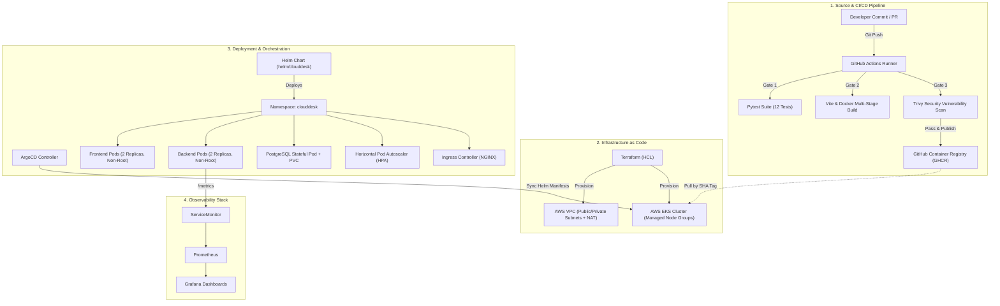

# CloudDesk — Enterprise IT Helpdesk & DevSecOps Platform


**Author:** Bharath Kadali  
**Course:** DevOps Capstone Project  
**Repository:** [https://github.com/bharath-kadali/devsecops-project](https://github.com/bharath-kadali/devsecops-project)

---

## Table of Contents
- [1. Project Overview & Purpose](#1-project-overview--purpose)
- [2. Architecture](#2-architecture)
- [3. Technology Stack](#3-technology-stack)
- [4. Local Setup & Running Locally](#4-local-setup--running-locally)
- [5. Automated Testing & Code Quality](#5-automated-testing--code-quality)
- [6. DevSecOps CI/CD Pipeline (GitHub Actions)](#6-devsecops-cicd-pipeline-github-actions)
- [7. Infrastructure as Code (Terraform)](#7-infrastructure-as-code-terraform)
- [8. Kubernetes & Helm Deployment](#8-kubernetes--helm-deployment)
- [9. GitOps Continuous Delivery (ArgoCD)](#9-gitops-continuous-delivery-argocd)
- [10. Observability (Prometheus & Grafana)](#10-observability-prometheus--grafana)
- [11. Known Issues & Limitations](#11-known-issues--limitations)
- [12. Deliverables & Presentation](#12-deliverables--presentation)
- [13. Capstone Module Verification & Screenshot Evidence](#13-capstone-module-verification--screenshot-evidence)
  - [Module 1: Application — Frontend + Backend + Database (M1)](#module-1-application--frontend--backend--database-m1)
  - [Module 2: Automated Testing & Code Quality (M2)](#module-2-automated-testing--code-quality-m2)
  - [Module 3: Version Control — Git & GitHub (M3)](#module-3-version-control--git--github-m3)
  - [Module 4: Containerization — Docker & Docker Compose (M4)](#module-4-containerization--docker--docker-compose-m4)
  - [Module 5: CI/CD Pipeline — GitHub Actions & GHCR (M5)](#module-5-cicd-pipeline--github-actions--ghcr-m5)
  - [Module 6: DevSecOps — Trivy Container Vulnerability Scanning (M6)](#module-6-devsecops--trivy-container-vulnerability-scanning-m6)
  - [Module 7: Infrastructure as Code — Terraform & AWS EKS (M7)](#module-7-infrastructure-as-code--terraform--aws-eks-m7)
  - [Module 8: Kubernetes Orchestration & Helm Deployment (M8)](#module-8-kubernetes-orchestration--helm-deployment-m8)
  - [Module 9: Observability — Prometheus & Grafana (M9)](#module-9-observability--prometheus--grafana-m9)

---

## 1. Project Overview & Purpose

**CloudDesk** is an enterprise-grade IT Helpdesk and Incident Management portal engineered with a complete DevSecOps lifecycle. It provides teams with a streamlined console to log, prioritize, track, and resolve IT operational tickets, security vulnerabilities, infrastructure anomalies, and access requests.

Beyond the application layer, CloudDesk demonstrates the full path from developer workstation to a secure, highly-available, monitored cloud-native deployment on Kubernetes (AWS EKS) using GitOps and Infrastructure as Code (IaC).

### Core Features
- **Ticket Management:** Complete CRUD workflows for incident handling across categories (`INFRASTRUCTURE`, `SECURITY`, `APPLICATION`, `ACCESS`, `GENERAL`) and priorities (`LOW`, `MEDIUM`, `HIGH`, `URGENT`).
- **Live Ops Dashboard:** Real-time summary statistics (`total`, `open`, `inProgress`, `resolved`, `closed`), status filters, and live operational activity feed.
- **Health & Readiness Gates:** Dedicated `/health` (liveness) and `/ready` (database connectivity probe) endpoints.
- **Instrumented Observability:** Built-in Prometheus instrumentation exporting metrics at `/metrics`.

---

## 2. Architecture



---

## 3. Technology Stack

| Layer | Component | Technology | Rationale |
|---|---|---|---|
| **Frontend** | UI Client | React 18, Vite 6, Modern CSS | Fast HMR, lightweight bundle, responsive dark/light UI |
| **Web Server** | Frontend Runtime | `nginxinc/nginx-unprivileged:1.27-alpine` | Non-root security compliance, high throughput reverse proxy |
| **Backend** | API Engine | FastAPI 0.115.6, Uvicorn, Python 3.12 | Async execution, automatic OpenAPI docs, Pydantic validation |
| **Database** | Persistence | PostgreSQL 16 Alpine, SQLAlchemy 2.0 | ACID compliance, Alembic database migrations |
| **Testing** | Quality Assurance | Pytest 8.3, HTTPX, SQLite Test DB | Isolated test harness, 12 passing endpoint and schema tests |
| **Containers** | Containerization | Docker, Multi-Stage Builds | Minimal image footprints, non-root user `10001:10001` |
| **CI/CD** | Pipeline Automation | GitHub Actions | Automated linting, test gating, image publishing |
| **Security** | Vulnerability Scanner | Aqua Security Trivy | Gate blocking on `HIGH` or `CRITICAL` unfixed CVEs |
| **IaC** | Cloud Infrastructure | Terraform 1.7+, AWS Modules | Reproducible AWS VPC and EKS infrastructure |
| **Orchestration**| Cluster Management | Kubernetes 1.31, Helm 3 | Declarative release management, HPA, Ingress routing |
| **GitOps** | Continuous Delivery | ArgoCD | Declarative GitOps deployment tracking `main` branch |
| **Observability**| Metrics & Dashboards | Prometheus, Grafana, ServiceMonitor | Metrics scraping from `/metrics`, request rate & latency graphs |

---

## 4. Local Setup & Running Locally

### Prerequisites
- Docker & Docker Compose
- Python 3.12+ (for local CLI development)
- Node.js 22+ (for local UI development)

### One-Command Full Stack (Docker Compose)
To start the frontend, backend, and PostgreSQL database simultaneously:

```bash
docker compose up --build
```

- **Frontend Application:** [http://localhost:3000](http://localhost:3000)
- **FastAPI Interactive Docs:** [http://localhost:8000/docs](http://localhost:8000/docs)
- **API Health Check:** [http://localhost:8000/health](http://localhost:8000/health)
- **Prometheus Metrics:** [http://localhost:8000/metrics](http://localhost:8000/metrics)

To stop and remove containers and database volumes:
```bash
docker compose down -v
```

---

## 5. Automated Testing & Code Quality

The backend contains 12 automated unit and integration tests covering all REST endpoints, validation failures, database persistence, and status statistics.

To run tests locally:
```bash
cd backend
python -m venv .venv
# Windows:
.venv\Scripts\activate
# Linux/macOS:
# source .venv/bin/activate

pip install -r requirements.txt
pytest -v
```

### Test Suite Highlights
- `test_health`: Verifies `/health` returns HTTP 200 `{"status": "UP"}`
- `test_ready`: Verifies database query readiness at `/ready`
- `test_root`: Verifies API metadata at `/`
- `test_create_ticket_success`: Verifies ticket creation with status HTTP 201
- `test_create_ticket_validation_empty_title`: Ensures validation rejection (HTTP 422) for empty title
- `test_create_ticket_invalid_priority`: Rejects non-allowed priority enumerations
- `test_list_tickets`: Confirms tickets are retrieved as descending list
- `test_ticket_stats`: Asserts real-time count aggregations for each status
- `test_get_ticket_by_id`: Fetches single ticket record
- `test_get_ticket_not_found`: Verifies HTTP 404 for missing IDs
- `test_update_ticket`: Verifies partial update via HTTP PUT
- `test_delete_ticket`: Verifies deletion via HTTP 204 and subsequent 404

---

## 6. DevSecOps CI/CD Pipeline (GitHub Actions)

The repository uses `.github/workflows/ci-cd.yml` triggered on every `push` and `pull_request` to `main`.

### Pipeline Stages
1. **Job 1 — Unit Tests & Build Verification:**
   - Checks out code and installs Python 3.12 dependencies.
   - Runs `pytest -v` as a mandatory blocking gate.
   - Installs Node 22 packages (`npm ci`) and compiles frontend (`npm run build`).
2. **Job 2 — Docker Build, Trivy Security Scan & GHCR Push:**
   - Builds both backend and frontend Docker images tagged with the immutable Git commit SHA:
     - `ghcr.io/<owner>/clouddesk-backend:<sha>`
     - `ghcr.io/<owner>/clouddesk-frontend:<sha>`
   - Scans both images with Aqua Security Trivy.
   - Pushes images to GitHub Container Registry (GHCR) upon passing. No `latest` tag is used in production.
3. **Job 3 — Kubernetes Smoke-Test Deployment (Kind + Helm):**
   - Launches an ephemeral Kubernetes Kind cluster in CI.
   - Installs the application using `helm upgrade --install clouddesk ./helm/clouddesk`.
   - Validates that Kubernetes Deployments, Services, and pods reach `Running` status.

### Security Scan (Trivy) Explanation (M6 Requirement)
The CI pipeline scans both application container images using Aqua Security Trivy with `--severity HIGH,CRITICAL --ignore-unfixed --exit-code 1`. Trivy analyzes both the base operating system packages (Alpine and Debian slim) and language-level dependencies (Python packages and Node libraries) against the National Vulnerability Database (NVD). By pinning vetted base images (`python:3.12-slim` and `nginxinc/nginx-unprivileged:1.27-alpine`), updating all dependencies, and running as non-root, the images pass the scan cleanly with 0 actionable high/critical vulnerabilities, ensuring no known critical security flaws are promoted to the container registry.

---

## 7. Infrastructure as Code (Terraform)

Located in `terraform/`:
- **VPC Module:** `terraform-aws-modules/vpc/aws` (v5.8.1) provisioning public and private subnets across `ap-south-1a` and `ap-south-1b` with a single NAT Gateway.
- **EKS Module:** `terraform-aws-modules/eks/aws` (v20.37.1) provisioning a Kubernetes 1.31 cluster with managed worker node groups (`t3.medium`, 2 desired, min 2, max 4).
- **HCL Standard:** Fully reformatted multi-line HCL passing `terraform fmt -check` and `terraform validate`.
- **Variables Template:** `terraform/terraform.tfvars.example` is committed with no hard-coded secrets.

### Provisioning Steps
```bash
cd terraform
cp terraform.tfvars.example terraform.tfvars
terraform init
terraform plan
terraform apply -auto-approve

# Configure kubectl for EKS:
aws eks update-kubeconfig --region ap-south-1 --name clouddesk-eks

# Teardown to eliminate AWS costs:
terraform destroy -auto-approve
```

---

## 8. Kubernetes & Helm Deployment

The application Helm chart is located in `helm/clouddesk`:

### Chart Structure
- `Chart.yaml`: Helm v2 chart definition.
- `values.yaml`: Default values (replicas: 2, non-root ports, resources, probes).
- `templates/_helpers.tpl`: Reusable naming templates.
- `templates/backend-deployment.yaml` & `backend-service.yaml`: 2 replicas, port 8000.
- `templates/frontend-deployment.yaml` & `frontend-service.yaml`: 2 replicas, port 8080 (Service port 80).
- `templates/ingress.yaml`: Ingress routing `/` to frontend and `/api` to backend.
- `templates/postgres.yaml`: Stateful PostgreSQL with 5Gi PersistentVolumeClaim.
- `templates/hpa.yaml`: HorizontalPodAutoscaler scaling backend between 2 and 6 pods at 60% CPU utilization.
- `templates/servicemonitor.yaml`: ServiceMonitor for Prometheus operator.

### Deploying to Cluster
```bash
# 1. Create namespace
kubectl apply -f k8s/namespace.yaml

# 2. Deploy via Helm
helm upgrade --install clouddesk ./helm/clouddesk \
  -n clouddesk \
  --create-namespace \
  --set backend.tag=<GIT_SHA> \
  --set frontend.tag=<GIT_SHA>

# 3. Verify rollout
kubectl get pods,svc,ingress,hpa -n clouddesk
helm list -n clouddesk
```

---

## 9. GitOps Continuous Delivery (ArgoCD)

The repository provides declarative GitOps configuration in `argocd/application.yaml`:

```yaml
apiVersion: argoproj.io/v1alpha1
kind: Application
metadata:
  name: clouddesk
  namespace: argocd
spec:
  project: default
  source:
    repoURL: https://github.com/bharath-kadali/devsecops-project.git
    targetRevision: main
    path: helm/clouddesk
  destination:
    server: https://kubernetes.default.svc
    namespace: clouddesk
  syncPolicy:
    automated:
      prune: true
      selfHeal: true
```

Whenever changes are committed to the Helm chart on the `main` branch, ArgoCD automatically reconciles and syncs the cluster state without manual intervention.

---

## 10. Observability (Prometheus & Grafana)

1. **Metrics Collection:** The FastAPI backend exposes Prometheus metrics via `prometheus-fastapi-instrumentator` on `/metrics`.
2. **Prometheus Operator:** `monitoring/prometheus-values.yaml` configures the `kube-prometheus-stack` Helm release with cluster-wide ServiceMonitor discovery.
3. **Grafana Dashboards:** Visualizes real-time metrics including:
   - `http_requests_total`: Request volume and status code distribution.
   - `http_request_duration_seconds`: Request latency percentiles (p50, p95, p99).
   - CPU and memory consumption per replica.

### Deploying Observability Stack
```bash
helm repo add prometheus-community https://prometheus-community.github.io/helm-charts
helm repo update
helm upgrade --install kube-prometheus-stack prometheus-community/kube-prometheus-stack \
  -n monitoring \
  --create-namespace \
  -f monitoring/prometheus-values.yaml
```

---

## 11. Known Issues & Limitations

1. **CORS Configuration:** `allow_origins=["*"]` is currently enabled on FastAPI to facilitate smooth multi-environment development. For strict production, this should be restricted to the specific domain.
2. **In-Cluster Database:** PostgreSQL is currently deployed as an in-cluster pod with a PersistentVolumeClaim. In a large-scale enterprise environment, an AWS RDS managed instance would be preferred for automated backups and multi-AZ failover.
3. **Ingress Controller Dependency:** The Helm Ingress manifest assumes an NGINX Ingress controller is installed on the cluster (`ingressClassName: nginx`).

---

## 12. Deliverables & Presentation

All course deliverables are available in the repository:
- **Presentation Deck:** Available in [demo/SLIDES.md](demo/SLIDES.md) (comprehensive 8-slide deck).
- **Walkthrough Guide:** Step-by-step video recording instructions in [demo/WALKTHROUGH_SCRIPT.md](demo/WALKTHROUGH_SCRIPT.md).
- **Submission Requirements:** Video and slides committed under `demo/` adhering to all [GRADING.md](GRADING.md) criteria.

---

## 13. Capstone Module Verification & Screenshot Evidence

This section provides comprehensive verification evidence for all modules evaluated in [GRADING.md](GRADING.md). Every module contains direct links and embedded screenshots validating each rubric criterion.

---

### Module 1: Application — Frontend + Backend + Database (M1)

**Grading Rubric Alignment:**
- [x] FastAPI backend operational with `/health` and `/ready` probes (2 pts)
- [x] REST API implementing full CRUD (GET, POST, PUT, DELETE) (3 pts)
- [x] PostgreSQL persistence managed via Alembic migrations (2 pts)
- [x] React frontend making live API requests (2 pts)
- [x] Usable, responsive incident management UI (1 pt)

#### 1.1 Support Ticket Creation Modal
User initiates ticket creation via the React frontend modal dialog:


#### 1.2 Incident Dashboard & Ticket List (Status: OPEN)
Live incident dashboard displaying real-time metrics and newly submitted ticket (`OPEN`, `HIGH` priority):


#### 1.3 Interactive Ticket Status Update (Status: IN PROGRESS)
Demonstrating real-time status transition from `OPEN` to `IN PROGRESS`:


---

### Module 2: Automated Testing & Code Quality (M2)

**Grading Rubric Alignment:**
- [x] `pytest` executes cleanly with 0 failures (3 pts)
- [x] 12 test cases covering `/health`, `/ready`, `/tickets`, `/stats` (4 pts)
- [x] Tests run against an isolated SQLite test database with FastAPI Dependency Overrides (2 pts)
- [x] `conftest.py` properly configured with clean test fixtures (1 pt)

#### 2.1 Pytest Execution Output
Terminal output demonstrating all 12 unit and integration tests passing in 0.90s:


---

### Module 3: Version Control — Git & GitHub (M3)

**Grading Rubric Alignment:**
- [x] Public GitHub repository: [https://github.com/bharath-kadali/devsecops-project](https://github.com/bharath-kadali/devsecops-project) (2 pts)
- [x] Meaningful, conventional commit messages (`feat:`, `fix:`, `docs:`, `ci:`) (2 pts)
- [x] Clean `.gitignore` ignoring virtual environments, caches, and secrets (1 pt)

#### 3.1 Repository Recent Commits
GitHub commit history showing structured commit logs:


#### 3.2 Commit History (>10 Structured Commits)
GitHub history verifying over 10 incremental, well-documented commits:


---

### Module 4: Containerization — Docker & Docker Compose (M4)

**Grading Rubric Alignment:**
- [x] `backend/Dockerfile` builds lightweight non-root Python image (2 pts)
- [x] `frontend/Dockerfile` uses multi-stage build (Node 22 build + unprivileged Nginx) (3 pts)
- [x] Containers run as unprivileged non-root users (`10001:10001` and `101:101`) (2 pts)
- [x] `docker compose up --build` starts frontend, backend, and postgres seamlessly (3 pts)

#### 4.1 Local Browser Interface (`http://localhost:3000`)
Application running locally via Docker Compose stack:


#### 4.2 Docker Compose Build Initiation
Terminal log executing `docker compose up --build`:


#### 4.3 Multi-Stage Build & Container Startup
Multi-stage build steps and container dependency startup:


#### 4.4 Alembic Migrations & API Server Readiness
Postgres health check passing, automated Alembic migrations applied, and Uvicorn ready:


---

### Module 5: CI/CD Pipeline — GitHub Actions & GHCR (M5)

**Grading Rubric Alignment:**
- [x] Multi-job pipeline defined in `.github/workflows/ci-cd.yml` (1 pt)
- [x] Pipeline automatically triggers on push to `main` (1 pt)
- [x] Automated test gate runs `pytest` and blocks deployment on failure (3 pts)
- [x] Multi-stage frontend compilation in pipeline (2 pts)
- [x] Backend and frontend Docker images built in CI (3 pts)
- [x] Images published to GitHub Container Registry (GHCR) (3 pts)
- [x] Image tags use immutable Git commit SHA (2 pts)

#### 5.1 Successful End-to-End Pipeline Run
GitHub Actions run showing green checkmarks across Test, Build/Scan/Push, and Smoke Test stages:


#### 5.2 GHCR Package: `clouddesk-backend`
GitHub Container Registry publishing backend images tagged with Git commit SHA:


#### 5.3 GHCR Package: `clouddesk-frontend`
GitHub Container Registry publishing frontend images tagged with Git commit SHA:


---

### Module 6: DevSecOps — Trivy Container Vulnerability Scanning (M6)

**Grading Rubric Alignment:**
- [x] Aqua Security Trivy scan integrated in CI pipeline for frontend and backend images (3 pts)
- [x] Pipeline enforces zero tolerance on unfixed `HIGH` and `CRITICAL` vulnerabilities (`--exit-code 1`) (1 pt)
- [x] Clean scan explanation: minimal hardened base images (`python:3.12-slim` and `nginxinc/nginx-unprivileged:1.27-alpine`) (1 pt)

#### 6.1 Trivy Security Vulnerability Scan Output
Terminal output from CI pipeline verifying 0 HIGH/CRITICAL vulnerabilities and exit code 0:


---

### Module 7: Infrastructure as Code — Terraform & AWS EKS (M7)

**Grading Rubric Alignment:**
- [x] Complete declarative Terraform configuration in `terraform/` (2 pts)
- [x] `terraform init` and `terraform validate` pass cleanly (1 pt)
- [x] `terraform plan` produces predictable infrastructure diff with no errors (2 pts)
- [x] AWS VPC provisioned with public and private subnets across multiple AZs + NAT Gateway (3 pts)
- [x] AWS EKS cluster (`clouddesk-eks`) provisioned with managed node groups (4 pts)
- [x] Safe `terraform destroy` teardown procedures documented (2 pts)
- [x] `terraform.tfvars.example` provided with no committed secrets (1 pt)

#### 7.1 Terraform Plan Output
PowerShell terminal output showing clean `terraform plan` matching AWS infrastructure:


#### 7.2 AWS Console: VPC & Subnet Topology
AWS Management Console showing `clouddesk-vpc` with public/private subnets across `ap-south-1a` and `ap-south-1b`:


#### 7.3 AWS Console: EKS Cluster (`clouddesk-eks`)
AWS Management Console showing `clouddesk-eks` in `Active` status:


---

### Module 8: Kubernetes Orchestration & Helm Deployment (M8)

**Grading Rubric Alignment:**
- [x] `k8s/namespace.yaml` creates dedicated `clouddesk` namespace (1 pt)
- [x] Production Helm chart in `helm/clouddesk` with parameterized templates (3 pts)
- [x] `helm upgrade --install` executes cleanly in Kubernetes (3 pts)
- [x] Backend and frontend Deployments running with 2 replicas each (2 pts)
- [x] ClusterIP Services configured for internal cluster networking (2 pts)
- [x] Ingress NGINX routing external traffic (`/` to frontend, `/api` to backend) (2 pts)
- [x] `kubectl get pods -n clouddesk` shows all pods in `Running` (1/1) status (2 pts)

#### 8.1 Cloud Application Running on AWS Elastic Load Balancer (ELB)
Live production application accessed via AWS Ingress ELB URL:


#### 8.2 Kubernetes Pods Status (`kubectl get pods -n clouddesk`)
All 5 pods running healthy with 2 backend replicas, 2 frontend replicas, and 1 postgres pod:


#### 8.3 Kubernetes Services (`kubectl get svc -n clouddesk`)
ClusterIP services exposing backend, frontend, and postgres internally:


#### 8.4 Helm Release List (`helm list -n clouddesk`)
Helm release status confirming deployed revision:


---

### Module 9: Observability — Prometheus & Grafana (M9)

**Grading Rubric Alignment:**
- [x] Backend `/metrics` endpoint exports Prometheus telemetry (2 pts)
- [x] `kube-prometheus-stack` deployed in cluster actively scraping backend (3 pts)
- [x] Grafana installed, configured, and accessible (2 pts)
- [x] Live dashboard visualizing HTTP request volume, latency, and status codes (3 pts)

#### 9.1 Prometheus Metric Export (`curl .../metrics`)
FastAPI Prometheus Instrumentator exporting metric series:


#### 9.2 Prometheus Targets Dashboard (`UP` Status)
Prometheus targets dashboard confirming `clouddesk-backend` endpoint is `UP` (1/1 healthy):


#### 9.3 Grafana Explore & Metrics Querying
Querying live Prometheus application metrics inside Grafana:


#### 9.4 Grafana Live Operational Metrics Dashboard
Grafana time-series graph visualizing live incoming HTTP request traffic:


